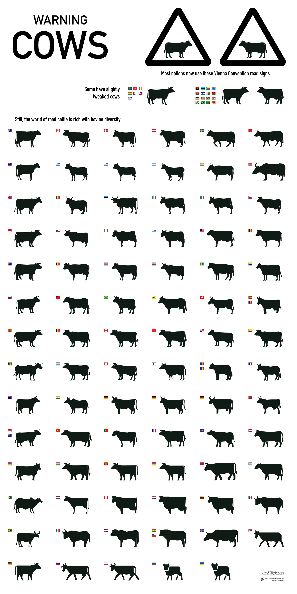

When I moved to the Netherlands and started riding out into the countryside polders, I was amused to see the square-assed cows on warning signs at cattle crossings. This led to me paying more attention, and I then noticed the signs in India had quite different horns. My curiousity led me to find that the contributors of Wikipedia had, of course, inventoried these [road signs from around the world](https://commons.wikimedia.org/wiki/Category:SVG_warning_road_signs_–_cattle).

In late 2026, at work with Quillbot I needed to test design production agents. So I natrually set them to the task of extracting the cow symbols from these signs while keeping track of their provenance. It was a great exercise that uncovered different approaches to subagent delegation, SVG inspection, and general model capabilities.

Eventually, I got a good stack of cows and was able to compile this reference poster. I am sure it will be found important and appear in classrooms everywhere.

<figure class="wide">
  
  <figcaption>Cows of the world (<a href="./cows.svg" rel="nofollow">SVG with tooltips</a>)</figcaption>
</figure>
